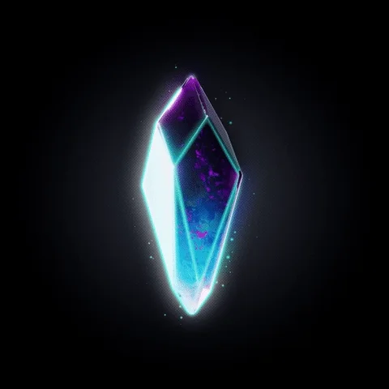
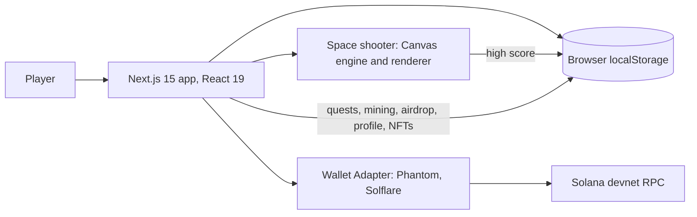
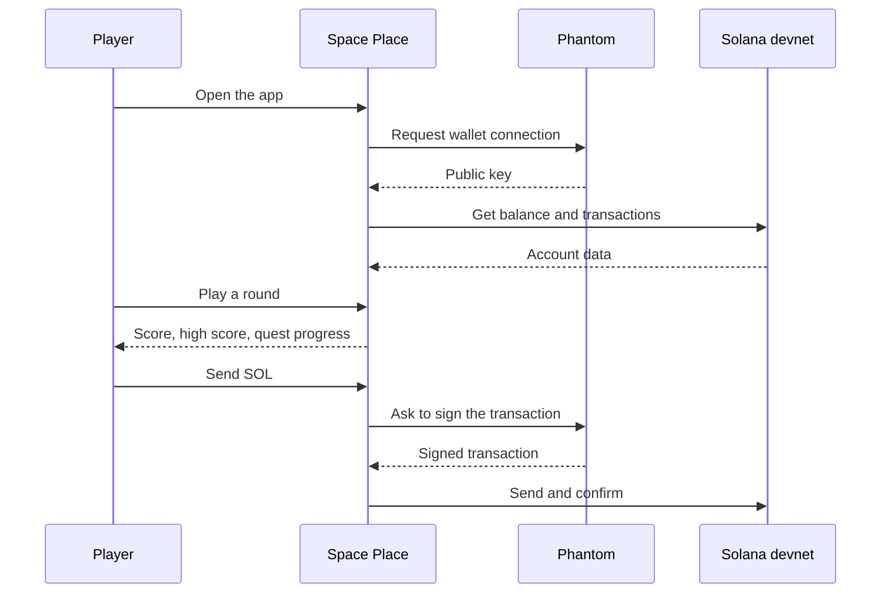

# Space Place

A Solana web game and mini-app: fly a ship in a space shooter, connect your Phantom wallet, complete quests and mine in-app gold, all in a mobile-first interface.

> **Built for the Colosseum Hackathon (Solana), 3rd place, Blockchain Innovation track, 2025.**
>
> **Status: hackathon prototype.** The wallet connection and the game are real. Quests, mining, airdrop, friends and NFT creation are demos that store data in the browser. See [Current state](#current-state).

<p align="center">
  
</p>

## Features

### Game
- **Space shooter** on HTML Canvas with a custom engine: collision detection, levels, rising difficulty and a score system.
- **Enemy waves** with several movement patterns (sine, cosine, fast zigzag and straight dive) and enemies that shoot back.
- **Power-ups** dropped by destroyed enemies: health, weapon power, shield and speed. Explosions and particle effects.
- **Ship selector:** choose between three ships, with a vector ship renderer as an option.
- **Fullscreen mode** and a high score saved on the device.
- Animated space background.

### Wallet
- **Phantom and Solflare** through the Solana Wallet Adapter, on desktop and mobile.
- **Mobile deep-link flow** for Phantom (`/mobile-connect`, `/phantom-connect`).
- Balance, recent transactions and SOL transfers with `@solana/web3.js` on **devnet**.
- Debug and test pages for wallet connection (`/wallet-test`, `/debug-wallet`, `/solana-demo`).

### App
| Page | What it does |
| --- | --- |
| `/space-shooter`, `/fullscreen-game` | The game |
| `/quests` | Daily and achievement quests with rewards |
| `/earns` | Gold miner with upgrades |
| `/airdrop` | Airdrop claim flow |
| `/leaderboard` | Player ranking |
| `/create-nft`, `/nft-collection`, `/nft/[id]`, `/sell` | NFT creation and collection flow |
| `/friends` | Friends list, requests and gifts |
| `/profile`, `/settings` | Profile and settings |

The interface is installable as a PWA-style app (web manifest) and is built for phones first.

## Architecture





## Tech stack

| Area | Tools |
| --- | --- |
| Framework | Next.js 15 (App Router), React 19, TypeScript |
| UI | Tailwind CSS, Radix UI, shadcn/ui, lucide-react, Recharts |
| Blockchain | `@solana/web3.js`, Solana Wallet Adapter (Phantom, Solflare) |
| Game | HTML Canvas, custom game engine and renderer in TypeScript |
| Forms and state | React Hook Form, Zod, React context |
| Package manager | pnpm |

## Project structure

```
app/                    Pages: game, quests, earns, airdrop, leaderboard, NFT, friends, profile
components/
  space-shooter/        Game engine, renderer, ship selector, animated background
  bottom-nav.tsx        Mobile navigation
  mobile-wallet-adapter.tsx
contexts/wallet-provider.tsx   Solana connection and wallet setup (devnet)
lib/
  solana.ts             Balance, transactions, SOL transfer, address check
  wallet-utils.ts       Connect helpers, mobile logic
  wallet-standard.ts    Wallet Standard support
public/                 Images and icons
```

## Getting started

Requirements: Node.js 18 or newer and pnpm.

```shell
git clone https://github.com/Godblessmylife/SpacePlaceSolana
cd SpacePlaceSolana
pnpm install
pnpm dev
```

Open http://localhost:3000. Install the Phantom extension (or open the app in the Phantom mobile browser) and switch the wallet to **devnet**. Get free test SOL from a devnet faucet.

| Command | Description |
| --- | --- |
| `pnpm dev` | Start the dev server |
| `pnpm build` | Production build |
| `pnpm start` | Run the production build |
| `pnpm lint` | Lint |

No environment variables are needed. The network is set in `lib/solana.ts` and `contexts/wallet-provider.tsx`.

## Current state

What works today:
- Wallet connection with Phantom and Solflare, balance, transactions and SOL transfers on devnet.
- The full space shooter game.

What is a demo in this version:
- Quests, mining, airdrop, profile, NFT creation and the high score are stored in `localStorage` on the device. They are not on-chain and are not shared between players.
- The friends list, requests, gifts and messages use sample data. There is no real chat yet.
- The leaderboard shows sample data.
- There is no custom on-chain program in this repository. Blockchain features use the Solana System Program through `@solana/web3.js`.

## Roadmap

- On-chain program (Anchor, Rust) for rewards, NFTs and the leaderboard.
- Backend and database for real player profiles, friends and chat.
- Mint NFTs on Solana (Metaplex) instead of the local demo.
- Server-side score validation.
- Mainnet support behind a network switch.
- Update the web manifest name and description, which still come from an earlier template.

## Author

Ioannes Avakian. Contact: masterofscience1993@gmail.com · [GitHub](https://github.com/Godblessmylife)
